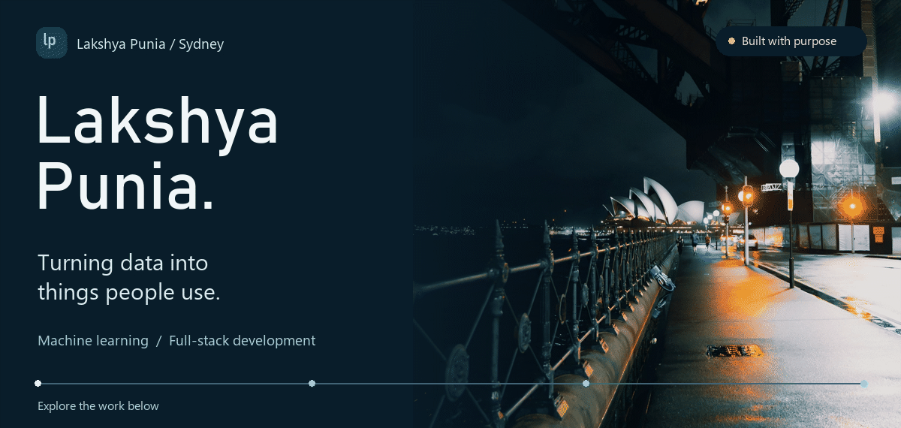
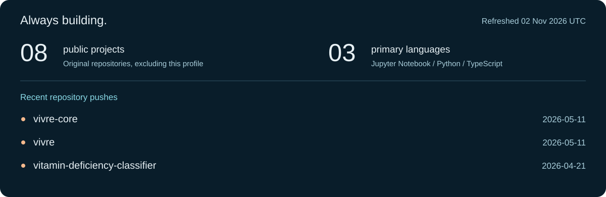

<picture>
  <source media="(prefers-reduced-motion: reduce)" srcset="assets/hero.png">
  
</picture>

  <a href="#selected-work">Selected work</a> &nbsp; / &nbsp;
  <a href="#the-toolkit">The toolkit</a> &nbsp; / &nbsp;
  <a href="#on-the-workbench">On the workbench</a> &nbsp; / &nbsp;
  <a href="https://github.com/LakshyaPunia?tab=repositories">All repositories</a>

I'm **Lakshya**, a builder based in Sydney. My work connects **data, machine learning, and product interfaces**: from understanding a city's train network to exploring how technology can support care.

I like projects where the data has somewhere useful to go.

## Selected work

### [Sydney Trains Pulse](https://github.com/LakshyaPunia/syd-trains-pulse)

**Making a moving city easier to understand.**

A Sydney Trains analytics dashboard with network delay heatmaps, skip-stop risk prediction, and a local natural-language query agent. A hybrid SQLite and Pandas engine connects live telemetry to a Streamlit interface.

`Python` &nbsp; `Pandas` &nbsp; `SQLite` &nbsp; `Streamlit`

[Explore the project](https://github.com/LakshyaPunia/syd-trains-pulse)

### [Vivre](https://github.com/LakshyaPunia/vivre-core)

**Exploring more connected care.**

A health-monitoring project being developed around elderly care: patient vitals, health trends, and family-facing interfaces. The repositories bring together a React and TypeScript frontend with Python models and backend work.

`TypeScript` &nbsp; `React` &nbsp; `Python` &nbsp; `Supabase`

[Frontend](https://github.com/LakshyaPunia/vivre-core) &nbsp; / &nbsp; [Models & backend](https://github.com/LakshyaPunia/vivre)

<b>More experiments in data & machine learning</b>

 

| Project | Exploration |
| :--- | :--- |
| [Diabetes Readmission Analysis](https://github.com/LakshyaPunia/Diabetes-Readmission-Analysis) | Analysis of patient readmissions across 130 US hospitals. |
| [Vitamin Deficiency Classifier](https://github.com/LakshyaPunia/vitamin-deficiency-classifier) | A notebook-based classification project. |
| [Rainfall Prediction](https://github.com/LakshyaPunia/Rainfall-prediction-using-machine-learning) | Exploring machine learning for rainfall prediction. |
| [InsightEdge](https://github.com/LakshyaPunia/InsightEdge) | An analytics project exploring churn, forecasting, and anomaly detection. |

## The toolkit

**Data & models** &nbsp; Python · Pandas · Jupyter · SQL 
**Interfaces** &nbsp; TypeScript · React · Tailwind CSS · Streamlit 
**Behind the scenes** &nbsp; SQLite · Supabase · Git

## On the workbench

Activity as text

<!-- ACTIVITY:START -->
**8 public projects** · **3 primary languages** · Updated 02 Nov 2026 (UTC).

- [vivre-core](https://github.com/LakshyaPunia/vivre-core) — last pushed 2026-05-11.
- [vivre](https://github.com/LakshyaPunia/vivre) — last pushed 2026-05-11.
- [vitamin-deficiency-classifier](https://github.com/LakshyaPunia/vitamin-deficiency-classifier) — last pushed 2026-04-21.
<!-- ACTIVITY:END -->

---

**Have an idea at the intersection of data and useful software?** 
Explore a repository, open an issue, or follow along as the projects develop.

[View the still banner](assets/hero.png) · [Photography credit](assets/CREDITS.md) · Activity uses public repositories only.
